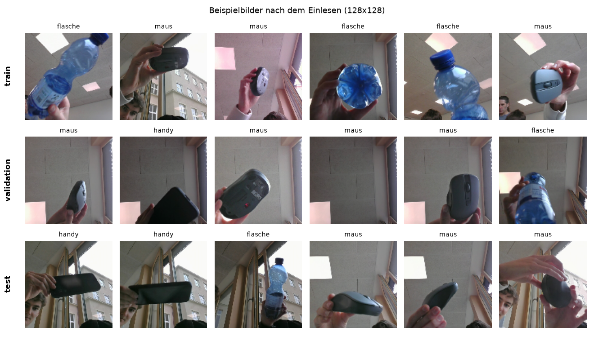
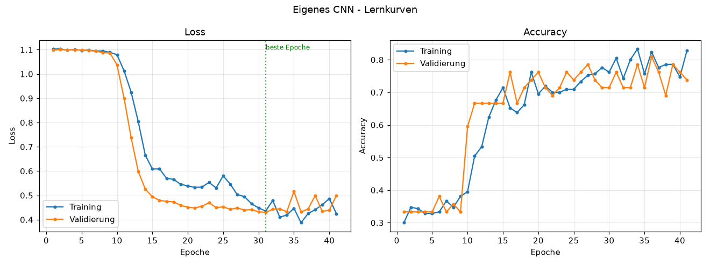
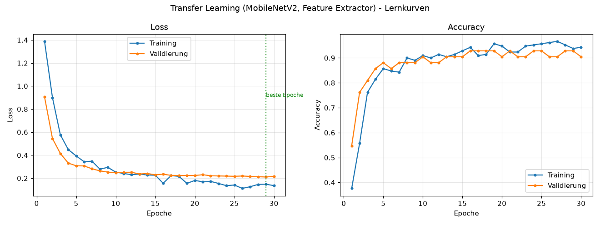
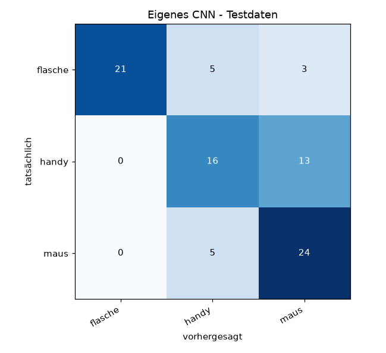
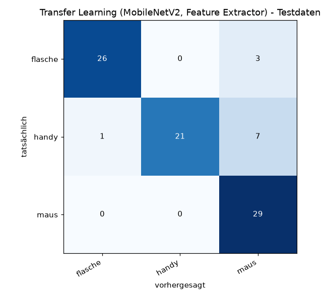
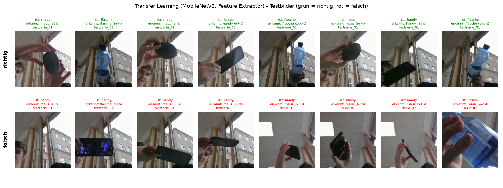

# Übung 03 – CNN mit Keras: Erkennung mit eigenen Bildern

**INFI-IS · 5xHWII** · Aufgabenstellung: [`aufgabe_3__cnn.pdf`](aufgabe_3__cnn.pdf) · Stand: alle Kapitel 1–10 fertig,
Datensatz aufgenommen, alle vier Modelle trainiert und ausgewertet

---

## Was dieses Projekt macht

Das Projekt erkennt mit einem neuronalen Netz, welcher von drei Gegenständen vor der Webcam liegt:
**Flasche, Handy oder Maus**. Es deckt den ganzen Weg von der Kamera bis zur Live-Vorhersage ab:

1. **Bilder aufnehmen** – ein Assistent führt durch 7 Aufnahmeserien pro Klasse und speichert die Webcam-Bilder
   in `rohbilder/` ([`capture_images.py`](capture_images.py)).
2. **Daten aufteilen** – die Serien werden als Ganzes auf `train` / `validation` / `test` verteilt
   ([`split_data.py`](split_data.py)).
3. **Daten einlesen** – Keras lädt die Ordner als Datensätze mit 128×128 Pixeln ([`load_data.py`](load_data.py)).
4. **Modelle trainieren** – vier Varianten: eigenes CNN, eigenes CNN mit Data Augmentation, Transfer Learning mit
   MobileNetV2 und Transfer Learning mit Fine-Tuning ([`train_cnn.py`](train_cnn.py),
   [`transfer_learning.py`](transfer_learning.py)).
5. **Auswerten und vergleichen** – Lernkurven, Konfusionsmatrix, Beispielbilder und eine Vergleichstabelle
   entstehen automatisch in `out/` ([`training.py`](training.py)).
6. **Vorhersagen** – für Bilddateien oder live im Kamerabild ([`predict.py`](predict.py)).

Im Repository liegen neben dem Code auch der aufgenommene Datensatz (`rohbilder/`, `data/`), die trainierten
Modelle (`out/modelle/*.keras`) und alle Auswertungen. Man kann also sofort `python predict.py --kamera` starten,
ohne vorher selbst zu trainieren.

### Ergebnis in Kürze

| Variante                                   | trainierte Parameter | Acc. train | Acc. validation | Acc. test | spätere Testbilder |
|--------------------------------------------|---------------------:|-----------:|----------------:|----------:|-------------------:|
| Eigenes CNN                                | 105.891              | 78,6 %     | 76,2 %          | 70,1 %    | 75,6 %             |
| Eigenes CNN + Data Augmentation            | 105.891              | 81,9 %     | 85,7 %          | 64,4 %    | 53,3 %             |
| **Transfer Learning (MobileNetV2)**        | **3.843**            | 97,1 %     | 92,9 %          | **87,4 %**| **91,1 %**         |
| Transfer Learning + Fine-Tuning            | 1.514.563            | 100,0 %    | 95,2 %          | 83,9 %    | 84,4 %             |

Am besten funktioniert Transfer Learning mit eingefrorenem MobileNetV2. Details stehen im Abschnitt
[Ergebnisse](#ergebnisse) und in [`out/vergleich.md`](out/vergleich.md).

---

## Schnellstart

```bash
pip install -r requirements.txt
```

```bash
python capture_images.py
```

**Unter Linux (Ubuntu)** gibt es nur `python3`, und die Windows-`.venv` aus Übung 02 funktioniert dort nicht. Die Umgebung
liegt deshalb außerhalb des Synology-Ordners unter `~/.venvs/kinz` (einmalig: `python3 -m venv ~/.venvs/kinz` und
`~/.venvs/kinz/bin/pip install -r requirements.txt`). Starten mit:

```bash
source ~/.venvs/kinz/bin/activate
```

```bash
python capture_images.py
```

Danach startet ein **Assistent**, der Schritt für Schritt durch alles führt. Im Hauptmenü steht immer der
*empfohlene nächste Schritt*. ENTER drücken genügt, um ihn auszuführen.

```
[1]  Klassen festlegen / ändern
[2]  Trainingsbilder aufnehmen          (Kapitel 3, geführt in 7 Serien)
[3]  Spätere Testbilder aufnehmen       (Kapitel 3, "Wichtiger Test")
[4]  Übersicht: was ist schon aufgenommen?
[5]  Daten aufteilen: train/validation/test   (Kapitel 4)
[6]  Daten mit Keras einlesen und prüfen      (Kapitel 4)
[7]  Eigenes CNN trainieren                   (Kapitel 5)
[8]  Eigenes CNN mit Data Augmentation        (Kapitel 7)
[9]  Transfer Learning mit MobileNetV2        (Kapitel 9)
[10] Live-Vorhersage mit der Kamera           (Kapitel 6 + 8)
[0]  Beenden
```

Alle Schritte gehen auch ohne Assistent direkt:

```bash
python split_data.py
python load_data.py
python train_cnn.py
python train_cnn.py --augmentation
python transfer_learning.py --finetuning
python predict.py --kamera
```

Man kann jederzeit mit **Q** abbrechen. Beim nächsten Start geht es genau dort weiter, wo man aufgehört hat.

---

## Dateien

```
Uebung_03/
├── capture_images.py     # Assistent + Kameraaufnahme (Kapitel 3), startet auch alle anderen Schritte
├── split_data.py         # Kapitel 4: serienweise Aufteilung in train/validation/test
├── load_data.py          # Kapitel 4: Einlesen mit image_dataset_from_directory (128x128)
├── train_cnn.py          # Kapitel 5 + 7: eigenes CNN, optional mit Data Augmentation
├── transfer_learning.py  # Kapitel 9: MobileNetV2 als Feature Extractor (+ Fine-Tuning)
├── training.py           # gemeinsam: Training, Auswertung, Plots, Vergleichstabelle
├── predict.py            # Kapitel 8: Vorhersage für Bilddateien oder Live-Kamera
├── config.py             # Pfade, Bildgröße, Serien-Anleitungen, Bilder pro Serie
├── requirements.txt
├── rohbilder/          # entsteht bei der Aufnahme
│   ├── klassen.json
│   └── <klasse>/serie_01 … serie_07/, testserie_01/ …
├── data/               # entsteht bei [5]
│   ├── train/<klasse>/
│   ├── validation/<klasse>/
│   ├── test/<klasse>/
│   └── aufteilung.json # welche Serie wo gelandet ist
└── out/
    ├── beispielbilder.png          # entsteht bei [6]
    ├── vergleich.md                # Tabelle aller Modelle, wird nach jedem Training aktualisiert
    ├── modelle/                    # cnn.keras, cnn_augmentation.keras, transfer.keras, ... + klassen.json
    ├── cnn/, cnn_augmentation/, transfer/, transfer_finetuning/
    │   ├── lernkurven.png          # Loss + Accuracy, Training vs. Validierung
    │   ├── konfusionsmatrix.png    # Testdaten
    │   ├── beispiele_richtig_falsch.png
    │   ├── architektur.txt         # model.summary() mit Parameterzahlen
    │   └── ergebnisse.json
    ├── vorhersagen.png             # predict.py mit Bilddateien
    └── kamera_vorhersagen/         # predict.py --kamera, LEERTASTE speichert
```

---

## Kapitel 1 – Aufgabenstellung: Wahl der Klassen

Mindestens **drei Gegenstände**, die leicht verfügbar sind und sich deutlich unterscheiden, zum Beispiel
`maus, smartphone, stift`. Ideal ist, wenn man von jeder Klasse ein **zweites Exemplar** hat, etwa eine
andere Maus. Damit lässt sich später testen, ob das CNN die Klasse gelernt hat oder nur den einen Gegenstand.
Gesten wie Schere–Stein–Papier sind ungeeignet, weil Hand, Person und Hautfarbe zusätzlich stark variieren.

## Kapitel 2 – Vorbereitung

* Keras/TensorFlow aus Übung 02, zusätzlich OpenCV: `pip install opencv-python` (Import: `import cv2`)
* Alle Pfade stehen zentral in [`config.py`](config.py) und sind relativ zum Ordner `Uebung_03`.
  Man muss also nichts an die eigene Umgebung anpassen.
* Wird keine Kamera gefunden, zeigt der Assistent die üblichen Ursachen an: Die Kamera ist von Teams/Zoom belegt,
  oder die Windows-Datenschutzeinstellung für Desktop-Apps blockiert den Zugriff.

## Kapitel 3 – Eigener Datensatz

### Geführte Aufnahme in 7 Serien (Menü 2)

Pro Klasse werden **7 Serien × 14 Bilder = 98 Bilder** aufgenommen (Vorgabe: 50–100). Jede Serie ändert
gezielt eine Bedingung:

| Serie | Was variiert wird                                    | landet in   |
|-------|------------------------------------------------------|-------------|
| 1     | Mitte, normaler Abstand, Gegenstand drehen           | train       |
| 2     | nah an der Kamera, verschiedene Seiten               | train       |
| 3     | weit weg, in alle Bildecken wandern                  | train       |
| 4     | anderer Hintergrund                                  | train       |
| 5     | andere Beleuchtung, schräge Blickwinkel              | train       |
| 6     | gemischt A (alles kombiniert)                        | validation  |
| 7     | gemischt B (alles kombiniert, möglichst anders)      | test        |

**Bedienung im Kamerafenster.** Zuerst ins Fenster klicken, sonst kommen die Tasten nicht an.

| Taste      | Funktion                                                                  |
|------------|---------------------------------------------------------------------------|
| LEERTASTE  | automatische Aufnahme starten/pausieren (3 s Countdown, dann alle 0,6 s ein Bild) |
| S          | einzelnes Bild aufnehmen                                                  |
| Z          | letztes Bild löschen                                                      |
| N          | Serie überspringen                                                        |
| Q / ESC    | zurück ins Menü (Fortschritt bleibt erhalten)                             |

Was der Assistent zusätzlich tut, damit der Datensatz gut wird:

* **Duplikatschutz:** Bei der automatischen Aufnahme werden fast identische Bilder übersprungen.
  Im Fenster erscheint dann „Gegenstand bewegen!“. Laut Angabe sollen die Bilder ja *bewusst unterschiedlich* sein.
* **Reihenfolge Serie für Serie:** Erst Serie 1 für alle Klassen, dann Serie 2 für alle Klassen usw.
  So sieht jede Klasse dieselben Hintergründe und dasselbe Licht. Nimmt man jede Klasse vor einem eigenen Hintergrund auf,
  lernt das CNN womöglich den Hintergrund statt des Gegenstands (*Dataset Bias*).
* **Quadratischer Ausschnitt:** Gespeichert wird nur das helle Quadrat in der Bildmitte (480×480 JPEG).
  Beim späteren Skalieren auf 128×128 wird der Gegenstand dadurch nicht verzerrt.

### Wichtiger Test: spätere Testbilder (Menü 3)

Diese Bilder entstehen **nicht während der eigentlichen Datensammlung**, sondern später unter anderen Bedingungen:
an einem anderen Tag, in einem anderen Raum, bei anderem Licht und vor einem neuen Hintergrund. Wenn möglich mit einem
**anderen Exemplar derselben Art**. Sie werden als `testserie_01`, `testserie_02` … gespeichert und kommen
**immer** in den Testdatensatz. Damit prüft man, ob das CNN die *Klasse* gelernt hat oder nur den konkreten
Gegenstand bzw. Hintergrund aus den Trainingsbildern.

## Kapitel 4 – Aufteilen und Einlesen

### Aufteilen (Menü 5 bzw. `python split_data.py`)

Die Aufteilung erfolgt **serienweise, nicht bildweise**. Unmittelbar hintereinander aufgenommene Bilder
unterscheiden sich kaum. Würde man einzelne Bilder zufällig auf train/validation/test verteilen, stünde zu fast
jedem Testbild ein beinahe identisches Bild im Training. Die Test-Accuracy wäre dann zu optimistisch und sagte
nichts über wirklich neue Bilder aus.

* Serien 1–5 → `train` (≈ 70 %). Jede Bedingung (nah, weit, Hintergrund, Licht …) kommt im Training vor.
* Serie 6 → `validation` (≈ 15 %), Serie 7 → `test` (≈ 15 %). Beide sind gemischte Serien, aber eigene
  Aufnahmen ohne Nachbarbilder im Training.
* `testserie_*` → zusätzlich `test`

Die Zuordnung ist für alle Klassen gleich. Sie steht in `data/aufteilung.json`, und jeder Dateiname behält seinen
Seriennamen, z. B. `serie_07__maus_serie_07_003.jpg`. So sieht man später bei Fehlklassifikationen sofort, aus
welcher Aufnahmesituation ein Bild stammt.

### Einlesen (Menü 6 bzw. `python load_data.py`)

```python
from load_data import load_datasets
train_ds, val_ds, test_ds, class_names = load_datasets()
```

* `keras.utils.image_dataset_from_directory()` für alle drei Ordner, Bildgröße **128×128**, Batchgröße 32
* `train` wird gemischt, `validation` und `test` nicht. So bleibt die Reihenfolge für spätere Auswertungen stabil.
* Es wird geprüft, ob alle drei Bereiche dieselben Klassen in derselben Reihenfolge haben.
* Die Pixelwerte bleiben bei 0–255. Die Normalisierung kommt in Kapitel 5 als `Rescaling(1/255)` **ins Modell**.
  Training und spätere Kamera-Vorhersage (Kapitel 8) verarbeiten die Bilder damit garantiert gleich vor.
* Ausgegeben werden Klassen, Batch-Form und Bildanzahl pro Klasse und Bereich. Zusätzlich wird
  `out/beispielbilder.png` mit Beispielen aus train/validation/test gespeichert.

## Kapitel 5 – Eigenes CNN (Menü 7 bzw. `python train_cnn.py`)

Selbst entworfene Architektur (Details und Begründung im Kopf von [`train_cnn.py`](train_cnn.py)):

```
Input 128×128×3  →  Rescaling(1/255)
Conv2D 16 (3×3, ReLU)  →  MaxPooling     128 → 64
Conv2D 32 (3×3, ReLU)  →  MaxPooling      64 → 32
Conv2D 64 (3×3, ReLU)  →  MaxPooling      32 → 16
Conv2D 128 (3×3, ReLU)                    16 × 16
GlobalAveragePooling  →  Dropout 0.3  →  Dense 64 (ReLU)  →  Dense <Klassen> (Softmax)
```

* **Vier** Faltungsschichten, damit die letzte Schicht große Bildbereiche „sieht“ (Gegenstände füllen bei
  128 Pixeln einen großen Teil des Bildes).
* **GlobalAveragePooling statt Flatten:** Flatten nach 16×16×128 ergäbe allein in der Dense-Schicht über
  2 Mio. Parameter. Bei nur ~70 Trainingsbildern pro Klasse wäre Overfitting damit fast sicher. So hat das
  ganze Modell nur rund **106.000** trainierbare Parameter (bei 3 Klassen).
* Adam (Lernrate 0,001), `sparse_categorical_crossentropy`, Early Stopping auf `val_loss` (Geduld 10 Epochen,
  beste Gewichte werden wiederhergestellt).

Dokumentiert wird automatisch:

| geforderte Angabe                         | wo                                                          |
|-------------------------------------------|-------------------------------------------------------------|
| Architektur, trainierbare Parameter       | `out/cnn/architektur.txt`, Konsole, `out/vergleich.md`      |
| Accuracy auf Training und Validierung     | Konsole, `out/vergleich.md`                                 |
| Accuracy auf den Testdaten                | gesamt **und** getrennt nach `serie_07` / späteren Testbildern |
| Loss- und Accuracy-Verlauf                | `out/cnn/lernkurven.png`                                    |
| Beurteilung Overfitting                   | automatisch erzeugter Satz in Konsole und `out/vergleich.md` |

## Kapitel 6 – Generalisierung testen

Der Testdatensatz besteht aus zwei Teilen, die getrennt ausgewertet werden:

* `serie_07`: gemischte Serie aus **derselben** Aufnahmesitzung (gleicher Raum, gleicher Gegenstand)
* `testserie_*`: **später** aufgenommen (neuer Hintergrund, anderes Licht, anderes Exemplar)

Der Unterschied zwischen diesen zwei Zahlen ist genau die Frage aus Kapitel 6. Ist die Accuracy auf
`serie_07` hoch, auf `testserie_*` aber deutlich niedriger, hat das Modell vor allem die Aufnahmesituation gelernt.

Beispiele für richtige und falsche Vorhersagen (spätere Testbilder werden bevorzugt gezeigt):
`out/<variante>/beispiele_richtig_falsch.png`. Die sichersten Fehler stehen mit Dateinamen in `out/vergleich.md`.

Weitere eigene Versuche:

```bash
python predict.py --kamera
```

Mit LEERTASTE werden interessante Fälle samt Vorhersage in `out/kamera_vorhersagen/` gespeichert, etwa ein
unbekannter Hintergrund, Gegenlicht, sehr nah oder weit, der Gegenstand liegend oder ein anderes Exemplar. Danach:

```bash
python predict.py out/kamera_vorhersagen
```

Das erzeugt `out/vorhersagen.png` als Übersicht.

**Typische Gründe für Fehler** (zum Dokumentieren): ein Hintergrund oder Licht, das im Training nie vorkam; der
Gegenstand ist nur teilweise oder sehr klein im Bild; ähnliche Farbe und Form wie eine andere Klasse; eine Lage,
die nie fotografiert wurde (z. B. Unterseite); ein zweites Exemplar mit anderer Farbe, wenn das Modell vor allem
die Farbe gelernt hat.

**Zusatzexperiment Dataset Bias (optional):** Im Menü 1 neue Klassen anlegen, z. B. `bias_maus, bias_handy, bias_stift`,
und jede Klasse in allen Serien nur vor *ihrem eigenen* Hintergrund aufnehmen. Danach mit `split_data.py` und
`train_cnn.py` trainieren und mit `predict.py --kamera` einen Gegenstand vor den „falschen“ Hintergrund halten.
Erkennt das Modell den Hintergrund statt des Gegenstands, liegt die Vorhersage daneben.

## Kapitel 7 – Data Augmentation (Menü 8 bzw. `python train_cnn.py --augmentation`)

Dasselbe CNN, aber direkt nach dem Input folgt ein Augmentation-Block (nur beim Training aktiv, bei
`evaluate`/`predict` automatisch ausgeschaltet):

```python
augmentation = keras.Sequential([
    layers.RandomFlip("horizontal"),       # abschaltbar mit --ohne-spiegeln
    layers.RandomRotation(0.05),           # +/- 18 Grad
    layers.RandomTranslation(0.1, 0.1),    # bis 10 % verschieben
    layers.RandomZoom(0.1),
    layers.RandomBrightness(0.15),         # simuliert andere Beleuchtung
    layers.RandomContrast(0.15),
], name="augmentation")
```

Weil jede Epoche andere Varianten der Bilder zeigt, lernt das Modell langsamer. Darum gibt es mehr Epochen
(max. 120) und mehr Geduld beim Early Stopping (20). Der direkte Vergleich mit dem Modell aus Kapitel 5 steht in
`out/vergleich.md`. Zu erwarten wäre: Die Trainings-Accuracy sinkt etwas oder steigt langsamer, der Abstand
zwischen den Trainings- und Validierungskurven wird kleiner (weniger Overfitting), und die Accuracy auf den
späteren Testbildern steigt. Bei unserem Datensatz ist nur der erste Teil eingetreten: Die Validierungs-Accuracy
stieg von 76,2 % auf 85,7 %, die Accuracy auf den späteren Testbildern fiel aber von 75,6 % auf 53,3 %
(siehe [Ergebnisse](#ergebnisse)).

## Kapitel 8 – Vorhersage (Menü 10 bzw. `python predict.py`)

```bash
python predict.py bild.jpg
```

```bash
python predict.py data/test
```

```bash
python predict.py --modell cnn_augmentation --kamera
```

Die Bilder werden genau wie im Training vorbereitet: zuerst das mittige Quadrat ausschneiden (wie beim Aufnehmen),
dann bilinear auf 128×128 skalieren (wie `image_dataset_from_directory`). Die Pixelwerte bleiben bei 0–255, das
Normalisieren macht das Modell selbst. Ausgegeben werden die erkannte Klasse, ihre Wahrscheinlichkeit und die
Wahrscheinlichkeiten aller Klassen. Unter 70 % steht „unsicher“ daneben. Liegen die Bilder in Ordnern mit
Klassennamen (z. B. `data/test`), wird zusätzlich richtig/falsch angezeigt.

> Eine hohe Wahrscheinlichkeit heißt **nicht**, dass die Vorhersage stimmt. Softmax verteilt immer 100 % auf die
> bekannten Klassen. Auch eine leere Wand oder ein ganz anderer Gegenstand wird mit hoher Sicherheit
> einer der Klassen zugeordnet.

## Kapitel 9 – Transfer Learning (Menü 9 bzw. `python transfer_learning.py --finetuning`)

* **MobileNetV2** mit ImageNet-Gewichten, ohne den alten Kopf (`include_top=False`), Eingabe 128×128.
  Die Vorverarbeitung (Pixel → −1..1) ist als `Rescaling(1/127.5, offset=-1)` ins Modell eingebaut.
* Phase 1 – **Feature Extractor:** `base.trainable = False`. Trainiert wird nur
  GlobalAveragePooling → Dropout → Dense (bei 3 Klassen 1280·3 + 3 = **3.843** Parameter).
  Data Augmentation ist wie in Kapitel 7 dabei.
* Phase 2 – **Fine-Tuning (optional, `--finetuning`):** Die obersten 30 Schichten werden freigegeben und mit
  Lernrate 1e-5 weitertrainiert. BatchNorm bleibt eingefroren. In `out/transfer_finetuning/lernkurven.png`
  markiert eine gestrichelte Linie den Beginn des Fine-Tunings.
* Trainingszeit und Anzahl der trainierten Parameter beider Phasen stehen neben dem eigenen CNN in `out/vergleich.md`.

---

## Ergebnisse

### Datensatz

Drei Klassen: `flasche`, `handy`, `maus`. Pro Klasse 7 Serien × 14 Bilder plus eine spätere Testserie mit 15 Bildern,
insgesamt **339 Bilder** (480×480 JPEG).

| Bereich      | Serien                       | Bilder pro Klasse | Bilder gesamt |
|--------------|------------------------------|------------------:|--------------:|
| `train`      | `serie_01` – `serie_05`      | 70                | 210           |
| `validation` | `serie_06`                   | 14                | 42            |
| `test`       | `serie_07` + `testserie_01`  | 29 (14 + 15)      | 87            |



### Vergleich der vier Modelle

| Variante                              | trainierte Parameter | Epochen | Trainingszeit | Acc. train | Acc. validation | Acc. test | Test: `serie_07` (42 Bilder) | Test: `testserie_01` (45 Bilder) |
|---------------------------------------|---------------------:|--------:|--------------:|-----------:|----------------:|----------:|-----------------------------:|---------------------------------:|
| Eigenes CNN                           | 105.891              | 41      | 13 s          | 78,6 %     | 76,2 %          | 70,1 %    | 64,3 %                       | 75,6 %                           |
| Eigenes CNN + Data Augmentation       | 105.891              | 120     | 84 s          | 81,9 %     | 85,7 %          | 64,4 %    | 76,2 %                       | 53,3 %                           |
| Transfer Learning (Feature Extractor) | 3.843                | 30      | 23 s          | 97,1 %     | 92,9 %          | 87,4 %    | 83,3 %                       | 91,1 %                           |
| Transfer Learning + Fine-Tuning       | 1.514.563            | 60      | 63 s          | 100,0 %    | 95,2 %          | 83,9 %    | 83,3 %                       | 84,4 %                           |

Richtig erkannte Testbilder pro Klasse (von je 29):

| Variante                              | flasche | handy | maus |
|---------------------------------------|--------:|------:|-----:|
| Eigenes CNN                           | 21      | 16    | 24   |
| Eigenes CNN + Data Augmentation       | 19      | 16    | 21   |
| Transfer Learning (Feature Extractor) | 26      | 21    | 29   |
| Transfer Learning + Fine-Tuning       | 26      | 19    | 28   |

### Beobachtungen

* **Das Handy ist die schwierigste Klasse.** Alle vier Modelle verwechseln es am häufigsten mit der Maus
  (eigenes CNN: 13 von 29 Handy-Bildern als Maus erkannt). Beide sind dunkle, flache Gegenstände.
* **Das eigene CNN lernt zu wenig.** Schon auf den Trainingsbildern erreicht es nur 78,6 %. Es lernt die Bilder also
  nicht auswendig, sondern findet mit 210 Trainingsbildern keine ausreichend guten Merkmale. Das Early Stopping
  hat nach 41 Epochen abgebrochen (beste Epoche 31), weil der Validierungs-Loss wieder stieg.
* **Data Augmentation hat hier nicht geholfen.** Die Validierungs-Accuracy steigt zwar auf 85,7 %, auf den späteren
  Testbildern fällt das Modell aber auf 53,3 %. Fast alle Flaschen der Testserie werden mit 84–99 % Sicherheit als
  Maus erkannt. Das Modell ist also sehr sicher und liegt trotzdem falsch. Das Training lief außerdem die vollen
  120 Epochen (beste Epoche 112) und war damit noch nicht fertig.
* **Transfer Learning ist klar am besten**, mit nur 3.843 trainierten Parametern und 23 s Training. Es ist auch das
  einzige Modell, das alle 29 Maus-Bilder richtig erkennt und auf den späteren Testbildern über 90 % kommt.
* **Fine-Tuning verschlechtert das Ergebnis.** Die Trainings-Accuracy steigt auf 100 %, die Test-Accuracy sinkt von
  87,4 % auf 83,9 %. Mit 1,5 Mio. freigegebenen Parametern und 210 Bildern passt sich das Netz zu stark an die
  Trainingsbilder an.
* **`serie_07` ist nicht leichter als die spätere Testserie.** Bei drei von vier Modellen ist die Accuracy auf den
  späteren Testbildern gleich hoch oder höher. Die erwartete Lücke zwischen „gleiche Sitzung“ und „später“ zeigt sich
  nur beim CNN mit Augmentation. Bei 42 bzw. 45 Bildern machen wenige Bilder allerdings schon mehrere
  Prozentpunkte aus.

### Lernkurven und Konfusionsmatrix

| Eigenes CNN | Transfer Learning (Feature Extractor) |
|---|---|
|  |  |
|  |  |

Die Bilder der beiden anderen Varianten liegen in [`out/cnn_augmentation/`](out/cnn_augmentation) und
[`out/transfer_finetuning/`](out/transfer_finetuning). Beispiele für richtige und falsche Vorhersagen des besten
Modells:



### Live-Test mit der Kamera

In [`out/kamera_vorhersagen/`](out/kamera_vorhersagen) liegen 8 Bilder aus der Live-Vorhersage. Der Dateiname enthält
die erkannte Klasse und die Wahrscheinlichkeit: Flasche und Handy wurden mit 0,99–1,00 erkannt, die Maus mit
0,71–0,94.

---

## Kapitel 10 – Antworten auf die Fragen

**1. Warum reicht es nicht aus, nur die Accuracy auf den Trainingsdaten zu betrachten?**
Das Modell hat genau diese Bilder beim Lernen gesehen und kann sie im Extremfall auswendig lernen. Eine hohe
Trainings-Accuracy sagt deshalb nur, dass das Modell die gesehenen Bilder kennt, nicht, dass es neue Bilder
richtig erkennt. Was später zählt, ist die Leistung auf ungesehenen Daten: Validierung, Test und vor allem die
später aufgenommenen Testbilder.

**2. Woran kann man Overfitting erkennen?**
An den Lernkurven: Der Trainings-Loss fällt weiter, während der Validierungs-Loss ab einer bestimmten Epoche
wieder steigt. Die Trainings-Accuracy erreicht fast 100 %, die Validierungs-Accuracy bleibt deutlich darunter
oder sinkt sogar. Ein großer Abstand zwischen Trainings- und Test-Accuracy zeigt dasselbe. Bei diesem Datensatz
kommt ein weiteres Zeichen dazu: Die Accuracy auf `serie_07` (gleiche Sitzung) ist viel höher als auf den
späteren Testbildern.

**3. Warum sind 100 fast identische Bilder schlechter als 100 möglichst unterschiedliche Bilder?**
Fast identische Bilder enthalten kaum neue Information. Für das Netz sind sie praktisch ein einziges Beispiel
mit viel Gewicht. Es lernt dann zufällige Details dieser einen Situation (Hintergrund, Licht, Lage) statt der
Merkmale, die die Klasse wirklich ausmachen. Unterschiedliche Bilder zwingen das Netz dagegen, das zu lernen,
was in allen Situationen gleich bleibt: die Form und die typischen Teile des Gegenstands. Außerdem täuschen fast
gleiche Bilder in Training und Test eine hohe Accuracy vor. Darum wird hier serienweise aufgeteilt.

**4. Was bewirkt Data Augmentation?**
Jedes Trainingsbild wird in jeder Epoche zufällig etwas verändert: gedreht, verschoben, gezoomt, gespiegelt,
heller oder dunkler. So entstehen künstlich viele zusätzliche, leicht unterschiedliche Trainingsbeispiele. Das
Netz kann sich die Bilder schlechter merken und lernt, dass Lage, Größe und Helligkeit nichts an der Klasse
ändern. Das verringert Overfitting und verbessert meistens die Generalisierung. Neue Hintergründe oder neue
Gegenstände kann Augmentation aber nicht erzeugen.

**5. Was versteht man bei einem Bilderkennungsmodell unter Generalisierung?**
Die Fähigkeit, auch Bilder richtig zu klassifizieren, die nicht aus den Trainingsdaten stammen: neue Aufnahmen
mit anderem Hintergrund, anderem Licht, anderem Abstand oder einem anderen Exemplar derselben Klasse. Ein Modell
generalisiert gut, wenn es das allgemeine Konzept („eine Maus“) gelernt hat und nicht nur die konkreten
Trainingsbilder („meine Maus auf meinem Schreibtisch“).

**6. Warum kann ein Modell eine hohe Test-Accuracy erreichen und trotzdem bei einem neuen Kamerabild schlecht
funktionieren?**
Weil die Testdaten den Trainingsdaten oft sehr ähnlich sind: gleiche Aufnahmesitzung, gleicher Raum, gleiches
Licht, gleicher Gegenstand, im schlimmsten Fall Nachbarbilder derselben Serie. Die Test-Accuracy misst dann nur
die Leistung in genau dieser Situation (*Data Leakage* bzw. *Dataset Bias*). Ein Live-Kamerabild bringt neue
Bedingungen mit (anderer Hintergrund, Gegenlicht, Bewegungsunschärfe, andere Kamera, Gegenstand nur teilweise
im Bild), die im Datensatz nicht vorkommen. Hinzu kommt: Das Modell kennt nur die eigenen Klassen und ordnet
jedes Bild einer davon zu, auch Bilder ohne einen dieser Gegenstände.

**7. Was ist der wesentliche Unterschied zwischen eurem selbst trainierten CNN und Transfer Learning?**
Das eigene CNN beginnt mit zufälligen Gewichten und muss alle Merkmale, von Kanten bis zu Gegenstandsteilen,
allein aus den paar hundert eigenen Bildern lernen. Beim Transfer Learning kommt der Faltungsteil von einem Netz,
das schon auf über einer Million ImageNet-Bildern trainiert wurde. Es kennt allgemeine Bildmerkmale bereits und
bleibt eingefroren. Nur ein kleiner neuer Klassifikationskopf (wenige tausend Parameter) lernt, diese Merkmale den
eigenen Klassen zuzuordnen. Deshalb reichen wenige Bilder, das Training geht schnell, und das Modell ist robuster
gegenüber neuen Hintergründen.

**8. Welche Variante hat bei eurem Datensatz am besten funktioniert und welche Beobachtungen erklären das Ergebnis?**
Am besten war **Transfer Learning mit eingefrorenem MobileNetV2**: 87,4 % Test-Accuracy und 91,1 % auf den später
aufgenommenen Testbildern, obwohl nur 3.843 Parameter trainiert wurden und das Training 23 s dauerte. Das eigene
CNN kommt auf 70,1 %, mit Data Augmentation auf 64,4 % (alle Zahlen im Abschnitt [Ergebnisse](#ergebnisse)).

Die Beobachtungen dazu:

* Das eigene CNN erreicht schon im Training nur 78,6 %. 210 Trainingsbilder reichen nicht, um Merkmale von Grund
  auf zu lernen, die Handy und Maus sicher trennen. Fast die Hälfte der Handy-Bilder wird als Maus erkannt.
* Data Augmentation hat bei uns die Validierung verbessert (85,7 %), aber nicht die Generalisierung: Auf den
  späteren Testbildern sinkt die Accuracy auf 53,3 %, und die Flaschen der Testserie werden mit bis zu 99 % als Maus
  erkannt. Augmentation erzeugt eben keine neuen Hintergründe oder Exemplare, und das Modell war nach 120 Epochen
  noch nicht fertig trainiert.
* MobileNetV2 bringt Merkmale aus über einer Million ImageNet-Bildern mit, die schon viele Hintergründe und
  Lichtverhältnisse gesehen haben. Der kleine neue Kopf kann kaum overfitten, darum liegen Trainings- und
  Validierungskurve nahe beieinander.
* Fine-Tuning war schlechter als der reine Feature Extractor (83,9 % statt 87,4 % im Test bei 100 % im Training).
  Mit 1,5 Mio. freigegebenen Parametern passt sich das Netz zu stark an die wenigen Trainingsbilder an.

### Weiterführende Überlegung: Image Classification vs. Object Detection

Das Modell in dieser Übung macht **Image Classification**: ein ganzes Bild, eine Klasse. Sollen mehrere
Gegenstände in einem Bild erkannt **und lokalisiert** werden, braucht es **Object Detection**. Das Modell gibt dann
für jeden gefundenen Gegenstand eine **Bounding Box** (x, y, Breite, Höhe), eine Klasse und eine Konfidenz aus.
Dafür ändert sich:

* **Daten:** Jedes Trainingsbild braucht Annotationen, also für jeden Gegenstand eine eingezeichnete Box mit
  Klasse (z. B. mit LabelImg, CVAT oder Roboflow). Ein Ordner pro Klasse reicht nicht mehr.
* **Modell:** Statt eines einzelnen Softmax-Ausgangs gibt es einen Detektionskopf, der an vielen Positionen der
  Feature Map gleichzeitig Box-Koordinaten und Klassenwahrscheinlichkeiten vorhersagt. Bekannte Architekturen sind
  YOLO und SSD (einstufig, schnell) sowie Faster R-CNN (zweistufig: erst Regionsvorschläge, dann Klassifikation).
  Meist gibt es zusätzlich eine Klasse „Hintergrund“ bzw. einen Objektness-Wert.
* **Loss:** eine Kombination aus Klassifikations-Loss und Regressions-Loss für die Boxen.
* **Auswertung:** Accuracy reicht nicht mehr. Man misst Intersection over Union (IoU) und mean Average Precision (mAP).
  Doppelte Boxen werden mit Non-Maximum Suppression entfernt.

In der Praxis nimmt man auch hier Transfer Learning: einen vortrainierten Detektor (z. B. YOLO, auf COCO
trainiert) und trainiert ihn mit eigenen annotierten Bildern nach.

---

## Anpassen

Alles Wichtige steht in [`config.py`](config.py): `IMAGES_PER_SERIES`, `IMAGES_PER_TEST_SERIES`, `IMG_SIZE`,
die Texte und die Aufteilung der Serien (`"split"`). Das Aufnahmetempo (`AUTO_INTERVAL`) und die Empfindlichkeit des
Duplikatschutzes (`DUP_THRESHOLD`) stehen oben in [`capture_images.py`](capture_images.py). Die maximale
Epochenzahl lässt sich bei allen Trainingsskripten mit `--epochen N` ändern.
